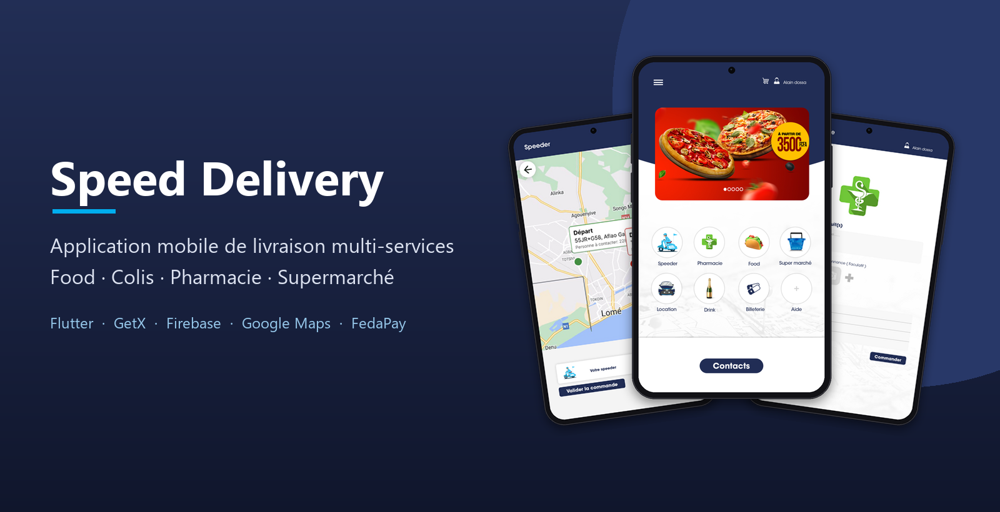
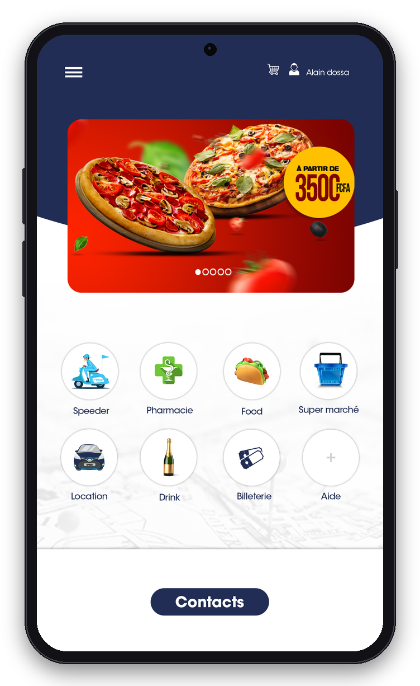
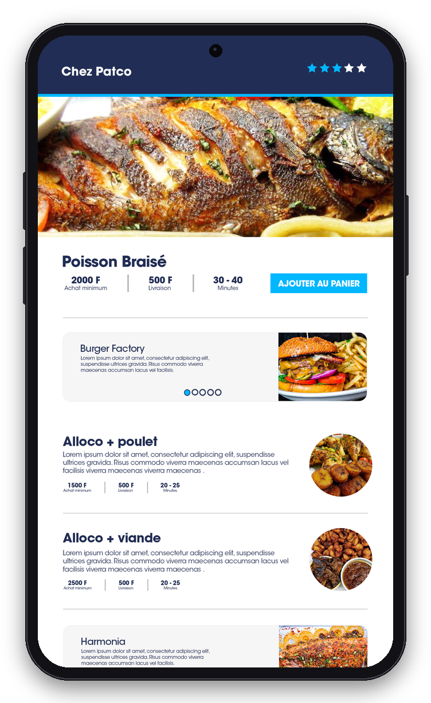
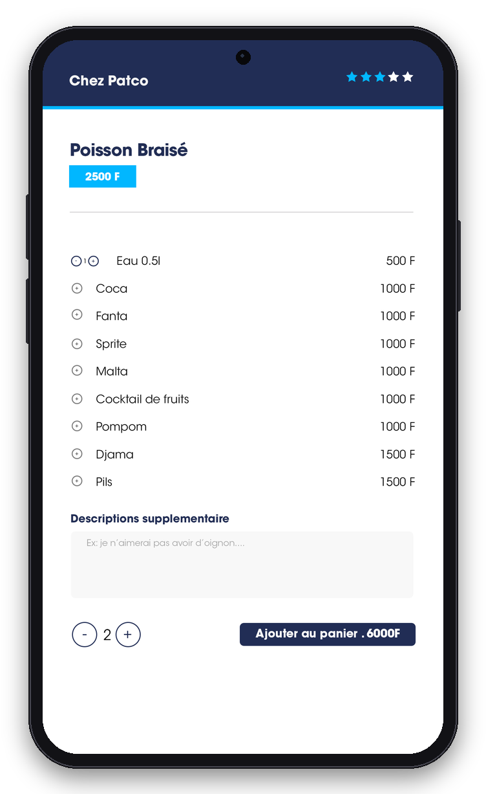
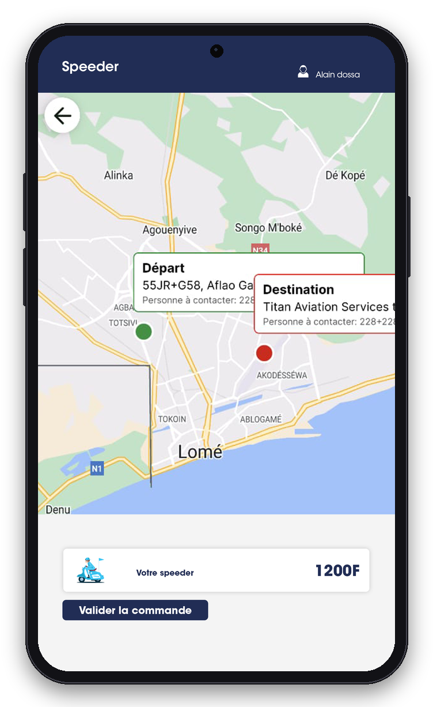
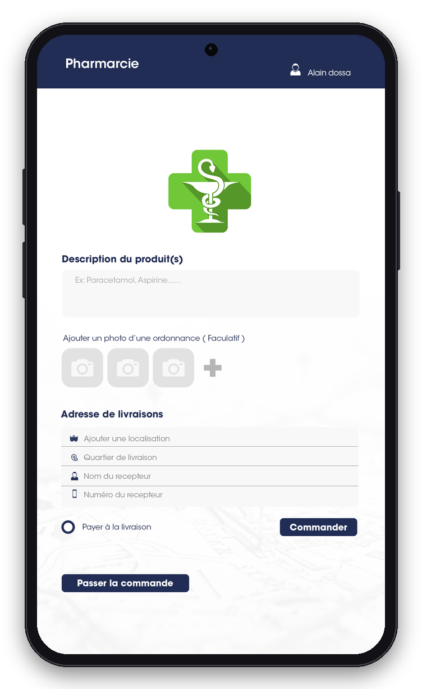
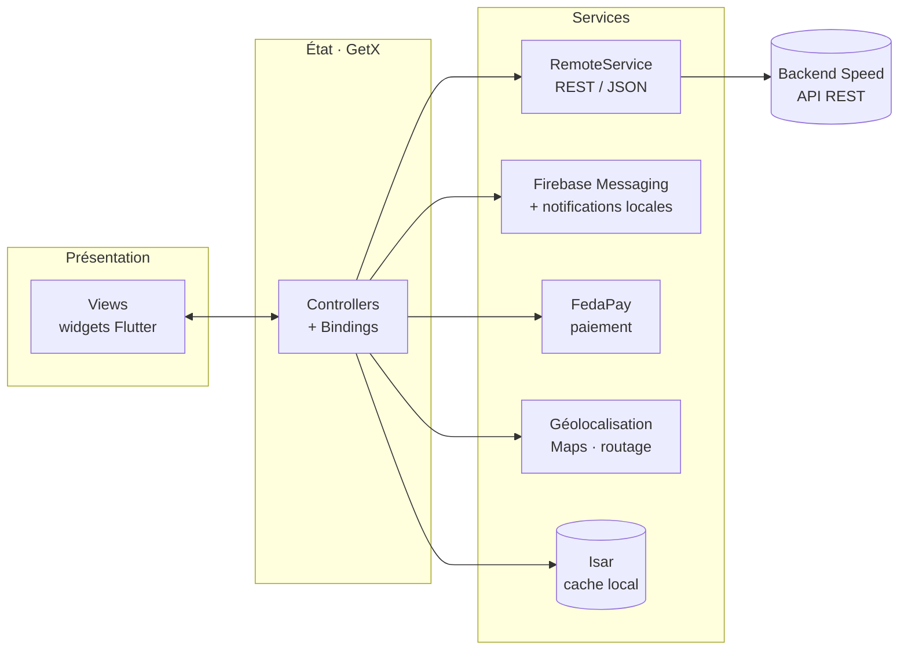

<p align="center">
  
</p>

<p align="center">
  
  
  
  
  
  
  
</p>

# Speed Delivery — application client

**Speed Delivery** est une application mobile de livraison à la demande développée pour **Speeder Services** à Lomé (Togo). Depuis une seule application, l'utilisateur commande un repas, des médicaments ou des courses, ou envoie un colis par un livreur (« Speeder »). Il suit ses commandes et paie depuis son téléphone.

> 🔒 **Le code source est privé (projet client).** Ce dépôt présente le produit, l'architecture et les problèmes techniques que j'ai résolus. Démo ou revue de code sur demande.

> 🇬🇧 *Cross-platform Flutter delivery app (food, parcels, pharmacy, groceries) built for a Togolese logistics company. I am the main developer (≈85 % of commits). Highlights: GetX architecture refactor (lint issues 615 → 41), Firebase Cloud Messaging with de-duplication, FedaPay mobile payments, geofenced address picking, offline mode.*

---

## 👤 Mon rôle

**Développeur mobile principal** : 103 des 122 commits du projet, de 2023 à 2026.

- Développement des modules métier, de l'intégration API REST et des notifications push
- **Refonte de l'architecture** : migration de Provider vers GetX et nettoyage complet du code
- Intégration du **paiement mobile FedaPay** et des **notifications de suivi de commande**
- Coordination avec l'équipe backend : contrats d'API, migration d'hébergement, bascule de domaine

## 📱 Aperçu

<table>
  <tr>
    <td align="center"><br><sub><b>Accueil</b><br>Tous les services</sub></td>
    <td align="center"><br><sub><b>Food</b><br>Carte du restaurant</sub></td>
    <td align="center"><br><sub><b>Food</b><br>Plat, boissons, panier</sub></td>
    <td align="center"><br><sub><b>Speeder</b><br>Envoi de colis</sub></td>
    <td align="center"><br><sub><b>Pharmacie</b><br>Ordonnance en photo</sub></td>
  </tr>
</table>

<sub>Visuels issus des maquettes UI (Sikka Communication) sur lesquelles l'application est construite.</sub>

## ✨ Fonctionnalités

| Module | Ce que fait l'utilisateur |
|---|---|
| 🍔 **Food** | Parcourt les restaurants, compose son plat avec les boissons, gère son panier et **modifie une commande déjà passée** |
| 🛵 **Speeder** | Choisit un point de départ et une destination sur la carte, voit le prix de la course, puis valide |
| 💊 **Pharmacie** | Décrit les produits voulus, joint une photo de l'ordonnance, indique l'adresse de livraison |
| 🛒 **Supermarché** | Fait une liste de courses livrée à domicile |
| 📦 **Commandes** | Suit les commandes en cours et consulte l'historique |
| 🔔 **Notifications** | Reçoit le prix final et le changement de statut en push (FCM) et règle directement depuis la notification |
| 💳 **Paiement** | Paiement mobile (Mobile Money) via FedaPay après la course |
| 🔐 **Compte** | Inscription et connexion par OTP SMS, profil, paramètres |
| 📡 **Hors ligne** | Détecte la perte de réseau et affiche un écran dédié, puis reprend quand la connexion revient |

## 🏗️ Architecture

Architecture **modulaire GetX** : un dossier par fonctionnalité, chacun avec sa vue, son contrôleur et son binding. Les services partagés sont injectés par dépendance.



```
lib/app/
├── modules/          # 21 modules : food, speeder_command, pharmacie, supermarket,
│                     # orders, current_orders, payment, notifications, maps, …
├── services/         # API REST, FCM, FedaPay, géocodage, routage, Isar
├── routes/           # navigation nommée GetX
├── themes/           # couleurs et typographie
└── widgets/          # composants réutilisables (AppSnackbar, cartes, formulaires)
```

## 🧩 Défis techniques résolus

| Problème | Ce que j'ai fait |
|---|---|
| **Dette technique** : état réparti entre Provider et GetX, avec 2 instances du store global | Migration progressive vers GetX, module par module, avec un plan écrit pour chacun. Le store est devenu une instance unique partagée. **Avertissements du linter : 615 → 41** |
| **Notifications en double ou incomplètes** | Contrat FCM aligné avec l'app livreur (id de course, prix final), anti-doublon, enregistrement du token auprès du backend, purge automatique |
| **Paiement** | Supprimé le pré-paiement au profit d'un règlement réel de la course terminée via FedaPay, accessible depuis la notification |
| **Géolocalisation** | « Ma position » échouait sans message sur 4 formulaires. J'ai corrigé ce bug, ajouté un contrôle de zone desservie et un libellé de repli |
| **Modification de commande** | Panier prérempli à partir de la vraie structure renvoyée par l'API, puis `PUT /orders/{id}` |
| **Session et cache** | Purge du cache local (Isar) en fin de session, redirection propre vers la connexion sur `401` |
| **Infrastructure** | Migration vers la nouvelle API et le domaine définitif, suppression d'un contournement TLS devenu inutile |
| **Rendu** | Logos SVG des restaurants qui perdaient leurs couleurs : diagnostic, puis montée de version de `flutter_svg` |

## 🛠️ Stack

- **Framework** : Flutter / Dart (Android et iOS)
- **État et navigation** : GetX
- **Backend et cloud** : API REST, Firebase (Auth, Cloud Messaging, Storage)
- **Cartographie** : Google Maps, Geolocator, OpenRouteService (itinéraires), géocodage
- **Paiement** : FedaPay (Mobile Money)
- **Stockage local** : Isar, SharedPreferences
- **UX** : notifications locales, Lottie, détection de connectivité, écran de démarrage natif

---

<p align="center">
  <sub>Développé par <b>BARCOLA Vianney</b> (<a href="https://github.com/vianneyL2A">@vianneyL2A</a>) · Lomé, Togo</sub>
</p>
